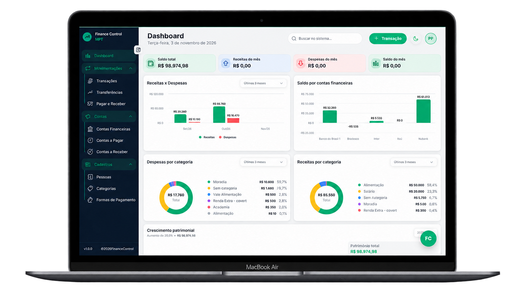
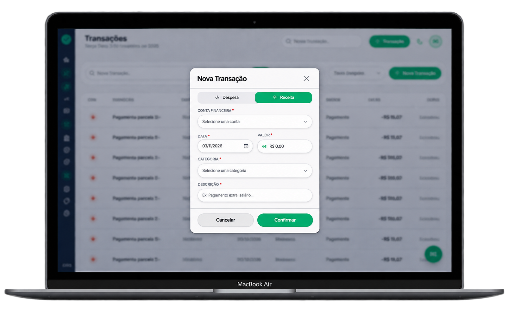
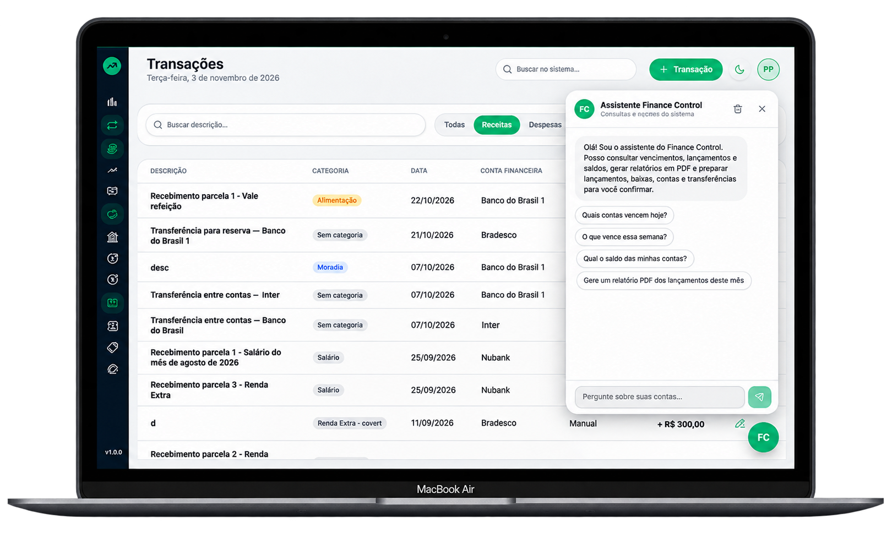
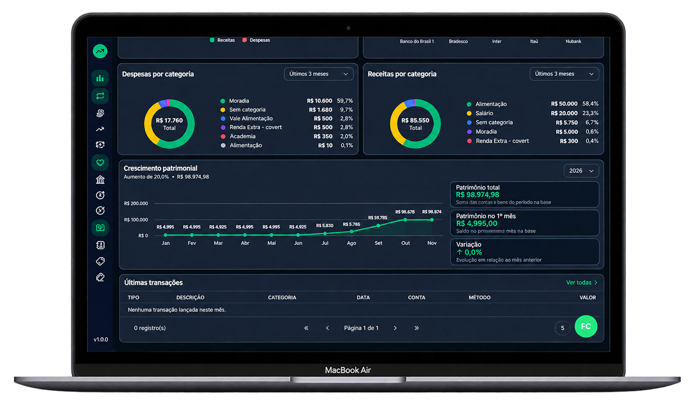
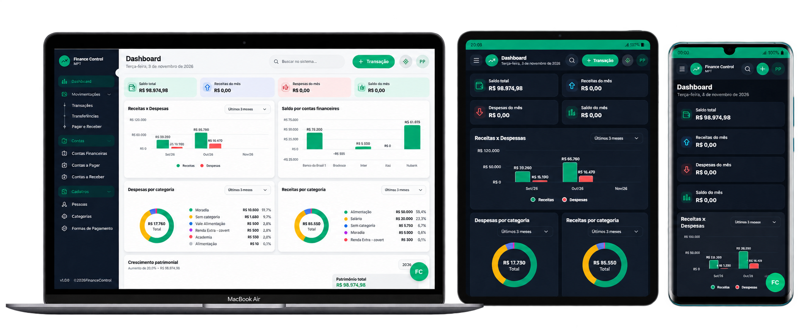
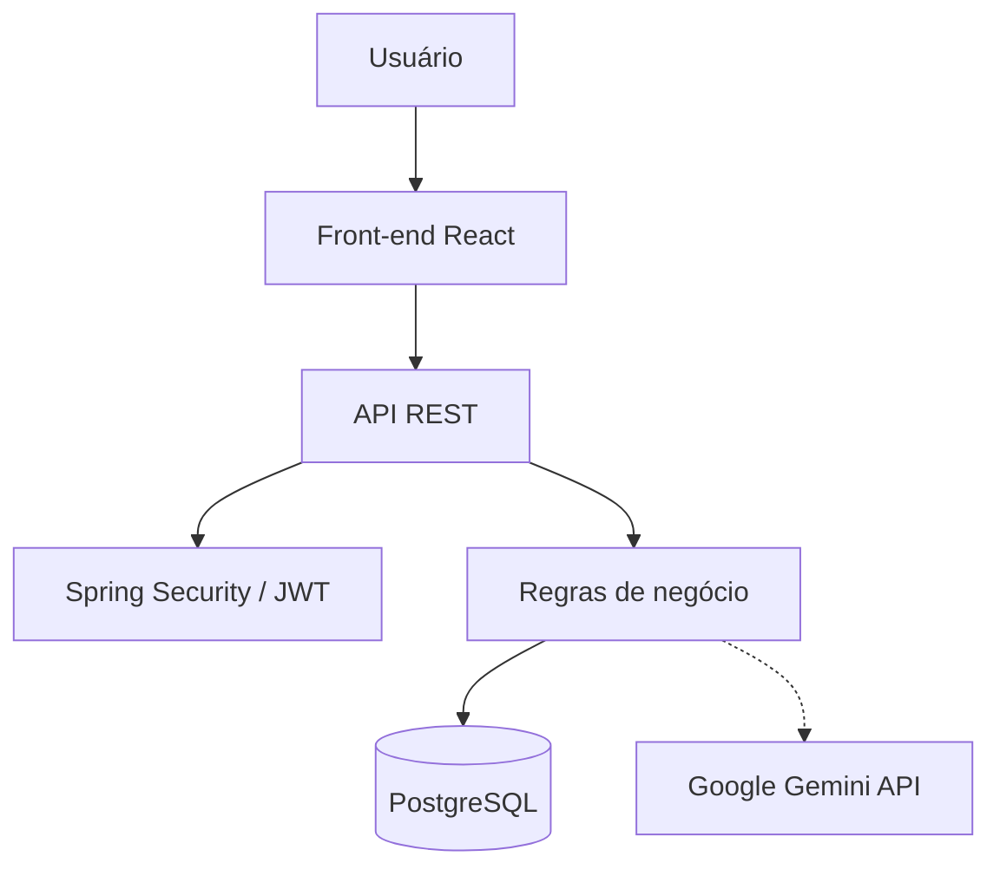

<h1 align="center">
  
  Finance Control MPT
</h1>

<p align="center">
  <strong>Pare de controlar o dinheiro em planilhas. Tenha toda a sua vida financeira em um só lugar.</strong>
</p>

<p align="center">
  <a href="https://jw.eroservice.com.br/finance-control/"><strong>🔗 Ver demo online</strong></a>
  &nbsp;·&nbsp;
  <a href="https://jw.eroservice.com.br/finance-control/api/swagger-ui/index.html"><strong>📘 Documentação da API</strong></a>
  &nbsp;·&nbsp;
  <a href="./DEPLOY.md"><strong>🚀 Deploy</strong></a>
</p>

<p align="center">
  
  
  
  
  
  
</p>

<p align="center">
  
</p>

---

## Sobre o projeto

Quem controla gastos em planilhas, anotações ou de cabeça costuma perder a visão do todo: não sabe para onde o dinheiro foi, quanto sobrou no mês nem onde está exagerando.

O **FinanceControl MPT** foi criado para resolver isso. É uma aplicação web full stack em que você registra receitas e despesas, organiza tudo por categorias e contas, acompanha a evolução em um dashboard e consulta relatórios. Para ganhar tempo, o nosso **assistente com IA** responde suas dúvidas e prepara resumos personalizados quando você pedir.

Projeto final da formação **Full Stack do +praTI/Codifica Edu**, desenvolvido por uma equipe de **9 pessoas**, com planejamento, divisão de responsabilidades e integração entre front-end, back-end e banco de dados até a publicação da aplicação.

## Funcionalidades

| Funcionalidade | O que você consegue fazer |
|---|---|
| 📊 **Dashboard** | Ver saldos, entradas, saídas e indicadores por período, com gráficos. |
| 💰 **Receitas** | Registrar tudo o que entra e saber de onde vem seu dinheiro. |
| 💸 **Despesas** | Registrar e acompanhar para onde o dinheiro está indo. |
| 🏷️ **Categorias** | Classificar as movimentações e enxergar onde você mais gasta. |
| 🏦 **Contas financeiras** | Separar o dinheiro por conta e acompanhar cada uma. |
| 📈 **Relatórios** | Consultar e analisar suas informações financeiras. |
| 🤖 **Assistente com IA** | Obter ajuda para interpretar seus gastos. |
| 🔐 **Autenticação** | Acesso protegido por login com JWT. |
| 📧 **Recuperação de senha** | Recuperar o acesso por e-mail. |
| 👤 **Perfil** | Gerenciar seus dados de usuário. |
| 🌗 **Temas** | Alternar entre modo claro e escuro. |
| 📱 **Design responsivo** | Usar o sistema no computador, no tablet ou no celular, com a interface adaptada à tela. |

## Interface da aplicação

### Dashboard

Visão geral das finanças, com indicadores, gráficos e acompanhamento do patrimônio.

<p align="center">
  
</p>

### Lançamentos e movimentações

Gerenciamento de receitas e despesas, com filtros e organização das movimentações.

<p align="center">
  
</p>

### Assistente com inteligência artificial

Assistente integrado para consultas e apoio à gestão financeira.

<p align="center">
  
</p>

### Tema escuro

Interface alternativa com tema escuro, mantendo a identidade visual da aplicação.

<p align="center">
  
</p>

### Experiência responsiva

A aplicação se adapta a diferentes tamanhos de tela, proporcionando uma experiência consistente em desktop, tablet e dispositivos móveis.

<p align="center">
  
</p>

## Destaques técnicos

- **API REST em Java 21 e Spring Boot 3**, com regras de negócio separadas da camada de acesso a dados.
- **Autenticação stateless com JWT e Spring Security**, protegendo as rotas da API sem depender de sessão no servidor.
- **Versionamento do banco com Liquibase**, para que o schema evolua de forma controlada e reproduzível entre ambientes.
- **API documentada com Swagger / OpenAPI**, facilitando testes e a integração com o front-end.
- **Integração opcional com Google Gemini**, isolada para que a aplicação funcione normalmente sem ela.
- **Ambiente reproduzível com Docker Compose e Nginx**, do desenvolvimento à publicação.
- **Front-end em React com Vite**, rotas com React Router e consumo da API via Axios, responsivo e com tema claro e escuro.

## Arquitetura

O FinanceControl MPT segue uma arquitetura cliente-servidor, com interface, API e persistência separadas.



O usuário interage com o React, que consome a API por HTTP. A API valida o acesso com Spring Security e JWT, aplica as regras de negócio e persiste os dados no PostgreSQL. O assistente com IA é um ponto de integração opcional com o Gemini.

## Tecnologias

<table>
  <tr>
    <th>Front-end</th>
    <th>Back-end</th>
    <th>Infraestrutura</th>
  </tr>
  <tr>
    <td valign="top">
      React<br />
      Vite<br />
      JavaScript<br />
      React Router DOM<br />
      Axios<br />
      CSS3<br />
      HugeIcons <br />
      Highcharts
    </td>
    <td valign="top">
      Java 21<br />
      Spring Boot<br />
      Spring Security + JWT<br />
      PostgreSQL<br />
      Liquibase<br />
      Swagger / OpenAPI<br />
      Google Gemini API
    </td>
    <td valign="top">
      Docker e Docker Compose<br />
      Nginx<br />
      Maven<br />
      Git e GitHub
    </td>
  </tr>
</table>

## Como executar

### Opção 1: Docker (mais rápido)

Pré-requisitos: [Git](https://git-scm.com/) e [Docker](https://www.docker.com/) com Docker Compose.

```bash
git clone https://github.com/mirraelly/finance-control-mpt.git
cd finance-control-mpt

cp .env.example .env      # ajuste as variáveis, se necessário
docker compose up --build
```

Quando os serviços subirem:

| Serviço | URL |
|---|---|
| Aplicação (front-end) | http://localhost:5173 |
| API | http://localhost:8080 |
| Documentação Swagger | http://localhost:8080/swagger-ui/index.html |

> O assistente com IA é opcional. Para ativá-lo, informe sua chave da API do Google Gemini no `.env`. Detalhes de configuração e publicação em [DEPLOY.md](./DEPLOY.md).

### Opção 2: Execução manual

Pré-requisitos: Git, Node.js 22, Java 21, PostgreSQL e Maven (ou Maven Wrapper).

**1. Clone o repositório**

```bash
git clone https://github.com/mirraelly/finance-control-mpt.git
cd finance-control-mpt
```

**2. Back-end**

```bash
cd financecontrol-api
```

Configure as variáveis de ambiente e o banco de dados seguindo o 📘 [README do Back-end](./financecontrol-api/README.md).

**3. Front-end** (em outro terminal)

```bash
cd financecontrol-front
npm install
npm run dev
```

Mais detalhes no 📘 [README do Front-end](./financecontrol-front/README.md).

## Estrutura do repositório

O repositório reúne duas aplicações independentes:

```text
finance-control-mpt/
│
├── financecontrol-front/    # Front-end (React + Vite)
├── financecontrol-api/      # Back-end (Java + Spring Boot)
│
├── docker-compose.yml       # Serviços para execução com Docker
├── .env.example             # Exemplo de variáveis de ambiente
├── DEPLOY.md                # Instruções de publicação
└── README.md
```

## Como trabalhamos
Para garantir a organização e a qualidade do código, adotamos práticas de desenvolvimento colaborativo:

- **Divisão de tarefas:** distribuição das atividades entre os integrantes.
- **Gestão do projeto:** acompanhamento das demandas pelo GitHub Projects.
- **Versionamento:** desenvolvimento em branches.
- **Pull Requests:** integração das funcionalidades por meio de PRs.
- **Code Review:** revisão do código antes dos merges.
- **Melhoria contínua:** aprimoramento constante do código e dos processos.

O projeto também proporcionou a experiência de trabalhar com um fluxo de trabalho em equipe, aplicando práticas utilizadas no desenvolvimento de software.

## Status do projeto

O projeto possui uma versão publicada e configuração para
execução local e conteinerizada.

A aplicação reúne recursos de gerenciamento financeiro,
autenticação, relatórios e integração opcional com IA.

## Equipe

Desenvolvido por uma equipe de 10 estudantes do programa **+praTI**, unindo conhecimentos e experiências para construir uma aplicação full stack.

## Equipe

<div align="center">

  <table>
    <tr>
      <td align="center">
        <a href="https://github.com/Eduardo-Ohlweiler">
          
          <br />
          <strong>@Eduardo-Ohlweiler</strong>
        </a>
      </td>
      <td align="center">
        <a href="https://github.com/mirraelly">
          
          <br />
          <strong>@mirraelly</strong>
        </a>
      </td>
      <td align="center">
        <a href="https://github.com/julianaviguis">
          
          <br />
          <strong>@julianaviguis</strong>
        </a>
      </td>
      <td align="center">
        <a href="https://github.com/pedrobaum05">
          
          <br />
          <strong>@pedrobaum05</strong>
        </a>
      </td>
      <td align="center">
        <a href="https://github.com/anthonyvargas02">
          
          <br />
          <strong>@anthonyvargas02</strong>
        </a>
      </td>
    </tr>
    <tr>
      <td align="center">
        <a href="https://github.com/vinny7x">
          
          <br />
          <strong>@vinny7x</strong>
        </a>
      </td>
      <td align="center">
        <a href="https://github.com/DiogoFlrs">
          
          <br />
          <strong>@DiogoFlrs</strong>
        </a>
      </td>
      <td align="center">
        <a href="https://github.com/Emillymoscardini">
          
          <br />
          <strong>@Emillymoscardini</strong>
        </a>
      </td>
      <td align="center">
        <a href="https://github.com/DiogoFlores51">
          
          <br />
          <strong>@DiogoFlores51</strong>
        </a>
      </td>
      <td align="center">
        <a href="https://github.com/DiogoFlrsss">
          
          <br />
          <strong>@DiogoFlrsss</strong>
        </a>
      </td>
    </tr>
  </table>

</div>

## Agradecimentos

Agradecemos ao **+praTI e à Codifica Edu** pela oportunidade de aprendizado e desenvolvimento profissional, e ao professor **[Jaques](https://github.com/jhyago)** que acompanhou nossa turma durante essa jornada, compartilhando conhecimentos e orientações importantes para a construção do projeto.

Aos colegas de equipe, nosso reconhecimento pela dedicação, parceria e troca de experiências ao longo do desenvolvimento.

O **Finance Control** é resultado dessa construção conjunta e representa a aplicação prática dos conhecimentos adquiridos, além da experiência com tecnologias, versionamento, gestão de tarefas e práticas de desenvolvimento de software.

---

<p align="center">
  Gostou do projeto? Deixe uma ⭐ no repositório.
</p>